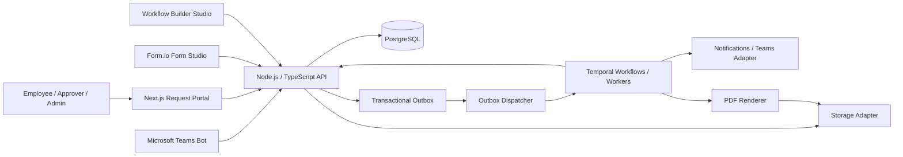

# System Architecture and Boundaries

**Status:** Proposed. **E-Office Runtime V2 is not reused as the new E-Request workflow engine.**

## Logical topology

## Build-vs-buy boundaries
- **Form.io JS Core**: visual authoring and rendering. Our API owns authentication, schema registry, validation policy, data and field authorization.
- **Synergy Codes Workflow Builder CE**: graph editor and possible execution integration; **POC must verify actual supported package APIs, node behavior and licensing at locked version**. Graph schema is not automatically executable.
- **Temporal**: durable orchestration; application owns business rules, task authorization, external callbacks, version compatibility.
- **Teams Bot**: sends cards, receives signed activity; bot channel ≠ native Teams Approvals product.
- **Document/PDF Service**: renders approved snapshot; result uploaded and checksum/metadata verified.

## Services/modules (initially modular monolith + dedicated workers)
1. Identity, organization, departments, roles, field-level rules.
2. Form registry/schema version and server-side evaluator.
3. Request aggregate + revisions + attachments.
4. Workflow authoring/validation/compiler and deployment version.
5. Human task service + decision API + audit.
6. Workflow adapter and Temporal workers.
7. Teams adapter / notification worker.
8. PDF rendering and object storage adapter.
9. Finance settlement module.

## Critical consistency contract
- DB transaction writes request/task state, audit and outbox event **together**.
- Outbox dispatch sends workflow start/decision signals **at least once**; consumers use deterministic IDs and dedupe.
- Each decision uses authenticated actor, expected task version and a unique idempotency key, with compare-and-set/row-lock concurrency.
- No Teams/HTTP/Temporal calls during database transaction.
- Temporal workflow controls next activation. API projections are persisted explicitly and reconciled if callback fails.
- External side effects (Teams send, PDF upload) are retryable and observable.
- Draft changes must not mutate submitted revision snapshots.

## Workflow compiling strategy
1. Author graph draft with typed nodes/ports and form field references.
2. Validate reachable End, no dangling ports, deterministic ELSE and exclusive branches, no unsupported cycles, assignee resolvability, type compatibility.
3. Publish an immutable signed/checksummed definition (`workflow_version`).
4. Compile graph to an internal typed plan; Temporal worker interprets nodes/awaits tasks, never runs arbitrary JS supplied by admins.
5. Lock engine compatibility per published version and test migration before any executor upgrade.

## Identity
Microsoft Entra SSO is proposed; implement OIDC server validation, map Entra subject/tenant to internal user IDs. Do not trust Teams message user names or email alone. Authorization always checks active user, organization scope and task assignment on the server.

## Storage
Persist attachments/approved PDF as immutable object keys and SHA-256 metadata. Adapter supports local dev and evaluated S3-compatible storage (e.g. SeaweedFS). Signed URLs short-lived; avoid exposing raw bucket links.

## Reconciliation
Workers periodically inspect unsent outbox messages, stuck approval signals, missing Teams card updates, artifact generation failures and orphan temporary files. Alert on repeated failures. Do not infer request completion from notification delivery.

## Deployment
See [Deployment Plan](17-DEPLOYMENT-PLAN.md). No production readiness claims until gated QA evidence.
