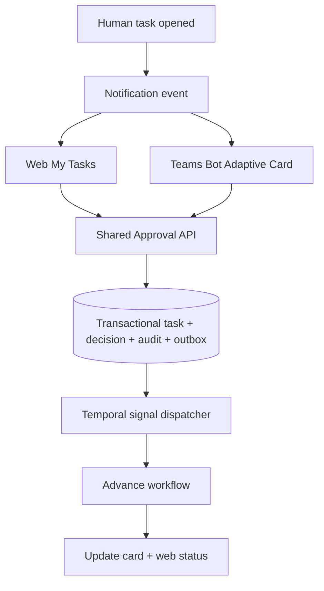

# Web + Microsoft Teams Approval Integration

**Status:** V1 target. The preferred V1 channel is a **custom Teams Bot + Adaptive Cards**. This is not the native Microsoft Teams Approvals product.

## Decision source of truth
An approval is a **business task in E-Request PostgreSQL**. Web and Teams invoke the same task decision endpoint. Temporal receives a durable outbox signal and advances the workflow. Teams card and UI updates are projections, not sources of authority.



## Recommended interaction contract
1. On activation: save task and notification outbox event; worker sends card; store `teams_conversation_id`, `activity_id`, card version and delivery state.
2. Card displays only allowlisted fields: type, request number, requester display (policy-dependent), summary, amount/currency and secure deep-link; never include bank account/attachments/OTP.
3. User taps Approve/Reject and optionally enters comment. Bot verifies signed Teams activity on bot endpoint and maps immutable Microsoft Entra ID to internal active user. Never trust a submitted `approverId`.
4. Bot calls the same authenticated decision command as Web, with task version and idempotency key.
5. API performs tenant-scope + assignment + task status + revision hash checks within a DB transaction; writes decision/audit/outbox atomically.
6. Outbox sends idempotent Temporal signal; update Teams card using stored activity reference; refresh web via polling or push events.
7. Stale card click returns already processed/expired with actual current decision; it **never** reopens task.

## Suggested approval-card payload (illustrative)
```json
{
  "taskId": "uuid",
  "requestNo": "PAY-2026-0001",
  "requestType": "PAYMENT",
  "display": {
    "department": "Sales",
    "amount": "25,000,000 VND"
  },
  "expectedTaskVersion": 3,
  "actions": ["APPROVE", "REJECT", "OPEN_REQUEST"]
}
```
The bot's external card payload is **not** authoritative: task actor, monetary amount and policy are re-read from the server.

## Exactly-once business decision (at-least-once transport)
- DB unique constraint on `(task_id, terminal_decision)` is **not enough** (approve/reject could each insert); serialize transition on one task row and enforce `PENDING → terminal` exactly once.
- Client `Idempotency-Key` de-duplicates retries of one command; different keys after terminal return existing result or conflict, never a second decision.
- Outbox event has unique event ID; Temporal signal handler stores processed event IDs / command ID.
- Sending Teams card twice due to retry should replace/upsert against persisted delivery record when possible; monitor duplicates.
- Only accept card actions through Teams Bot authenticated callback, **not** a simple incoming webhook.

## Failure paths
| Scenario | Expected result |
|---|---|
| Teams unavailable | task remains pending; web approval works; notification retry |
| Web approves before Teams action | Teams responds processed/expired and refreshes card |
| Entra account not provisioned | deny decision, instruct user to contact IT |
| Approver disabled/reassigned | deny stale user; task owner policy applies |
| Temporal unreachable | decision saved; outbox retries until workflow acknowledges |
| Wrong-tenant task ID | not found/forbidden without leaking task details |
| Teams actor impersonation | reject invalid activity signature and token |
| Both approve/reject simultaneously | one accepted; the other conflict |

## Microsoft-native Approvals caveat
Power Automate `Create an approval` can create native Approvals work items, but claiming complete, bidirectional Web ↔ native Teams Approvals requires separate POC and platform support verification. Microsoft Graph beta approval APIs must not be assumed production-supported. Power Automate HTTP connector may be blocked by company DLP. **Do not silently substitute the native Approvals UI for this bot design.**

## Operational prerequisites
Company Microsoft 365 tenant administrator approves custom Teams App, Azure/Microsoft Entra app registration, bot messaging permissions/hosting, callback domain and firewall, data residency/privacy review, service account and cost/license checks. No secrets in repo.

## Links for implementation research
- [Microsoft Teams Adaptive Cards universal actions](https://learn.microsoft.com/en-us/microsoftteams/platform/task-modules-and-cards/cards/universal-actions-for-adaptive-cards/overview)
- [Teams bots and cards documentation](https://learn.microsoft.com/en-us/microsoftteams/platform/bots/what-are-bots)
- [Power Automate approvals](https://learn.microsoft.com/en-us/power-automate/get-started-approvals)
- [Power Platform DLP](https://learn.microsoft.com/en-us/power-platform/admin/wp-data-loss-prevention)
