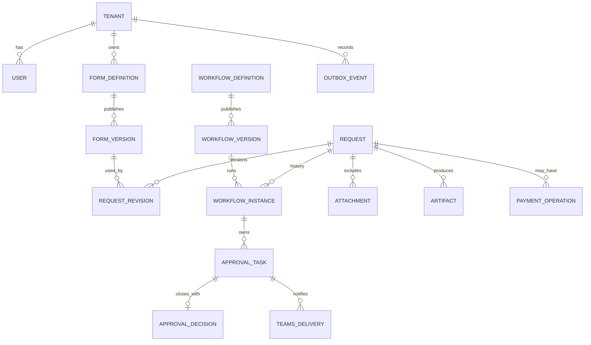

# Logical Data Model — PostgreSQL

**Status:** Proposed ERD/column contracts; not a migrated schema. All business tables require organization scoping (e.g., `tenant_id`).

## Core table dictionary
| Table | Required conceptual attributes |
|---|---|
| `tenants` | id, name, status |
| `users` | id, tenant_id, entra_object_id, status, department_id, manager_user_id |
| `roles`, `user_roles` | tenant_id, role, permission scope |
| `form_definitions` | id, tenant_id, key, title, current_published_version_id |
| `form_versions` | id, form_id, version_no, json_schema, checksum, state, published_at |
| `workflow_definitions` | id, tenant_id, key, title, latest_version_id |
| `workflow_versions` | id, definition_id, version_no, graph_json, compiled_plan, compatibility_version, checksum |
| `request_types` | id, tenant_id, code, form_version_id, workflow_version_id, numbering_rule |
| `requests` | id, tenant_id, request_no, request_type_id, requester_user_id, approval_status, created_at |
| `request_revisions` | id, tenant_id, request_id, revision_no, form_version_id, workflow_version_id, validated_data_jsonb, data_hash, submitted_at |
| `workflow_instances` | id, tenant_id, request_id, revision_id, workflow_version_id, temporal_workflow_id, state |
| `approval_tasks` | id, tenant_id, workflow_instance_id, revision_id, node_key, assigned_user_id, version, status, activated_at |
| `approval_decisions` | id, tenant_id, task_id, actor_user_id, decision, comment, action_source, decided_at, idempotency_key |
| `attachments` | id, tenant_id, request_id, revision_id, storage_key, sha256, content_type, size, scan_status |
| `artifacts` | id, tenant_id, request_id, revision_id, kind, storage_key, sha256, state, generated_at |
| `payment_operations` | id, tenant_id, request_id, payment_state, paid_at, transaction_reference, processed_by |
| `teams_deliveries` | id, tenant_id, task_id, conversation_id, activity_id, state, last_attempt_at |
| `outbox_events` | id, tenant_id, aggregate_id, event_type, payload, dedupe_key, status, attempt_count, next_attempt_at |
| `audit_events` | id, tenant_id, entity_type/id, actor_id, action, before_hash, after_hash, timestamp |

## Data integrity constraints
- `UNIQUE(tenant_id, request_no)`.
- `UNIQUE(request_id, revision_no)`.
- `UNIQUE(form_id, version_no)`, `UNIQUE(definition_id, version_no)`.
- Only one terminal accepted approval decision per task (enforce through a lock/conditional update + unique `task_id` on terminal decision record).
- `UNIQUE(tenant_id, idempotency_key, command_scope)` for requests; `UNIQUE(outbox.dedupe_key)` with correctly scoped key.
- Foreign keys must not allow cross-tenant joins; enforce tenant-aware composite key constraints where practical.
- Immutable published definition/version and request revision after submit; corrections create new rows, not in-place edits.
- Use `NUMERIC`/integer-minor-units for money with explicit ISO currency; timezone-aware instants for audit.

## Reporting fields
Alongside JSONB, promote commonly indexed fields into typed columns or a versioned extraction table: request_no, type, amount_minor/currency, requester, department, cost center, date range, current assignee and age. Index JSONB only when justified by observed queries.

## Retention/audit
Event history and approved artifacts cannot be silently deleted. Authorized archive/retention policies to be defined by compliance owner. Don't store access tokens, OTP, Teams raw cards or bank account values in audit/event payload.

## Migration plan
Prisma (or another selected migration tool) additive migrations; no destructive reset against shared environments; backup/rehearse schema updates; test tenant isolation via two-org fixture.

## Physical authorization-aware relational design
**This file remains the logical overview.** The authoritative proposed physical additions are in [Physical Data Layer](22-DATA-LAYER-PHYSICAL-DESIGN.md), including `roles`, `permissions`, `role_permissions`, scoped `user_role_assignments`, `request_access_grants`, `approval_task_assignees`, `form_field_policies`, tenant-safe composite FKs, SQL indexes and uniqueness. Consult [Authorization Architecture](20-AUTHORIZATION-ARCHITECTURE.md), [Permission Matrix](21-PERMISSION-MATRIX.md), [RLS Operations](23-POSTGRESQL-RLS-OPERATIONS.md) and [001/002 SQL reference](../db/design/). No migrations have been executed.
