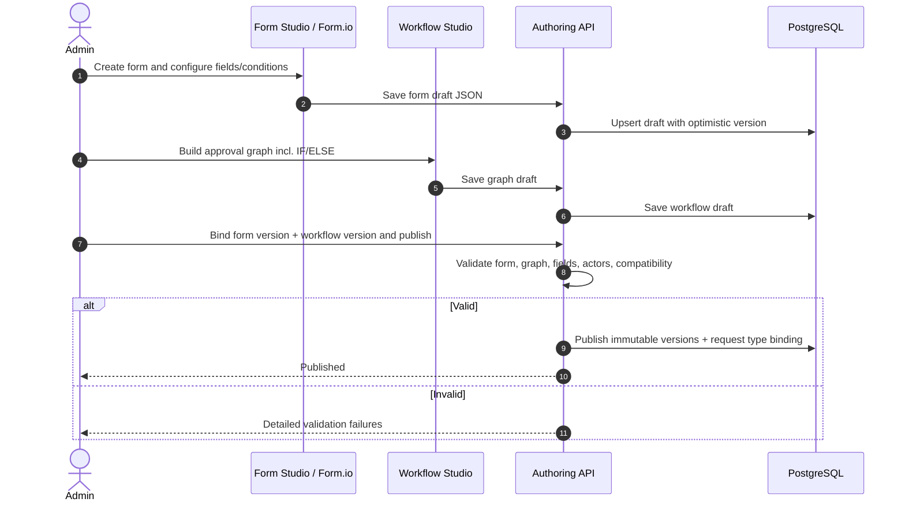
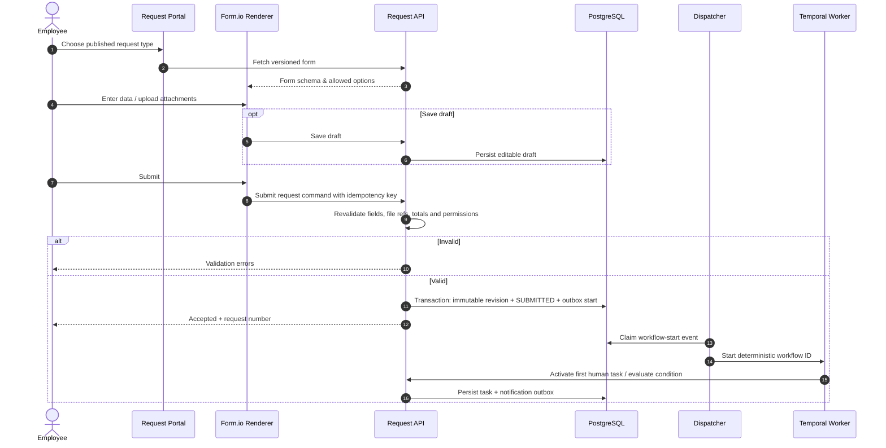
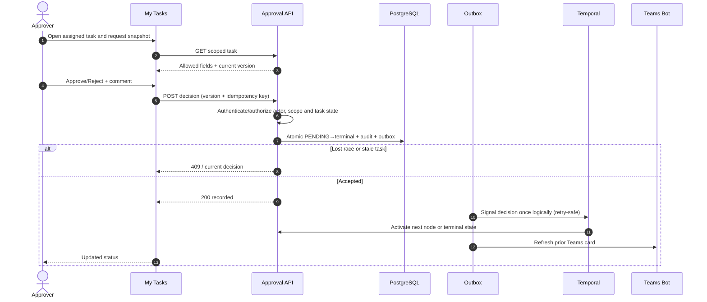
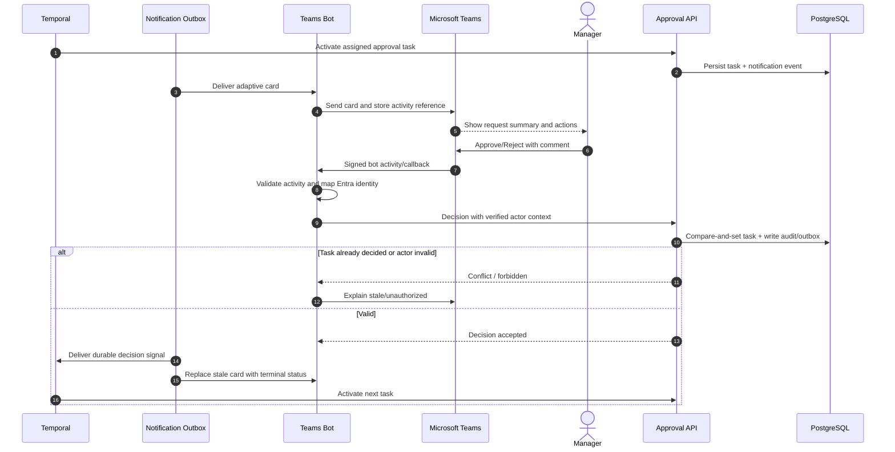
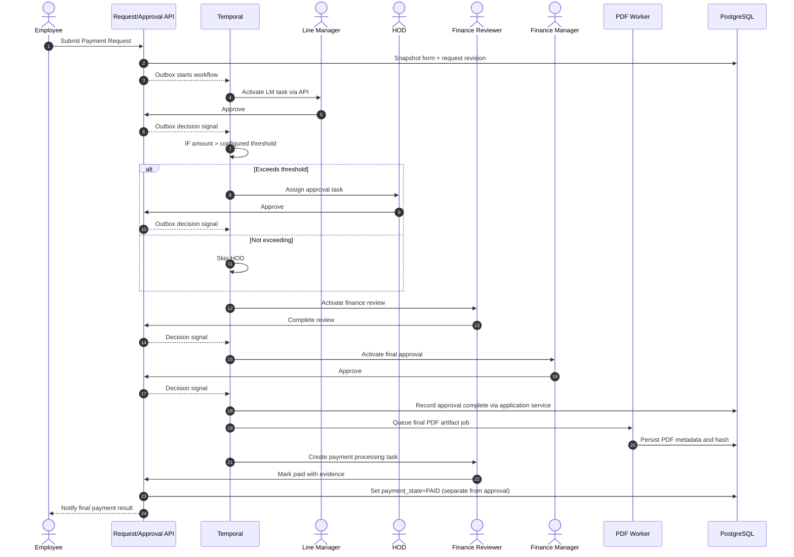
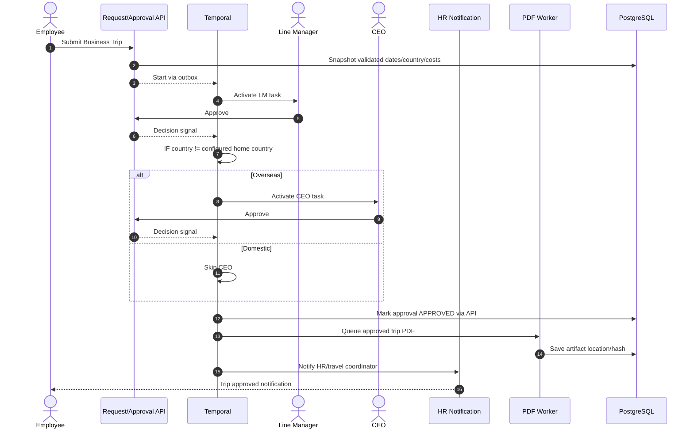

# E-Request V1 — Eight Sequence Diagrams

**Status:** Target behavior only; no code is claimed complete. Sequence actors are conceptual; the implementation must preserve transaction/outbox/authorization boundaries.

## SD-01 — Design, bind and publish a form and workflow


## SD-02 — Draft and submit a new request


## SD-03 — Approve / reject on Web


## SD-04 — Approve / reject from custom Teams Bot


## SD-05 — Payment Request, threshold branch and settlement


## SD-06 — Business Trip, overseas conditional


## SD-07 — Reject vs Return for Changes + resubmit
```mermaid
sequenceDiagram
  autonumber
  actor Approver
  actor Employee
  participant API as Request/Approval API
  participant DB as PostgreSQL
  participant O as Outbox
  participant T as Temporal
  Approver->>API: Decide REJECT or RETURN with reason
  API->>DB: Atomic decision + audit + outbox
  O->>T: Deliver decision event
  alt REJECT
    T->>API: Set request REJECTED and close pending tasks
    API-->>Employee: Rejection notification
  else RETURN
    T->>API: Mark CHANGES_REQUESTED and suspend progression
    API-->>Employee: Return comment
    Employee->>API: Save revised draft and resubmit
    API->>API: Validate full revised form, totals, attachments
    API->>DB: Persist immutable revision N+1 and outbox
    O->>T: Start revised workflow using new revision ID
    T->>API: Cancel/supersede old active tasks; restart required approvals
  end
```

## SD-08 — Final PDF, archive and retriable failures
```mermaid
sequenceDiagram
  autonumber
  participant T as Temporal
  participant API as Request Service
  participant DB as PostgreSQL
  participant O as Outbox Worker
  participant PDF as PDF Renderer
  participant S as Object Storage
  actor Employee
  T->>API: All required approvals completed
  API->>DB: Transaction APPROVED + artifact PENDING + outbox
  O->>DB: Claim artifact event
  O->>PDF: Render approved immutable revision
  PDF->>API: Load scoped request snapshot + decisions
  API-->>PDF: Canonical data and audit summary
  PDF->>PDF: Render static PDF
  PDF->>S: Write object with immutable key
  S-->>PDF: Stored
  PDF->>S: Verify readback/hash as configured
  alt Generation/storage success
    PDF->>DB: Save artifact hash/key; set READY
    Employee->>API: Download artifact
    API->>API: Authorize and audit download
    API->>S: Read object
    S-->>Employee: Authorized PDF download
  else Failure
    PDF->>DB: Record retryable failure
    O->>O: Backoff/retry or dead-letter alert
    Note over DB: Approval remains APPROVED; PDF not READY
  end
```

## Interpretation rules
- Where a user/actor arrow visually targets Temporal, actual user commands **must** traverse authenticated E-Request APIs.
- Outbox → Temporal and callback → DB are conceptual; API/worker implementations must be idempotent and transactional where stated.
- All graphs use **example** role and amount policies; business owners approve production routing.
- Workflow Studio should not be assumed to support arbitrary loops; return-for-changes uses revision/restart semantics.
