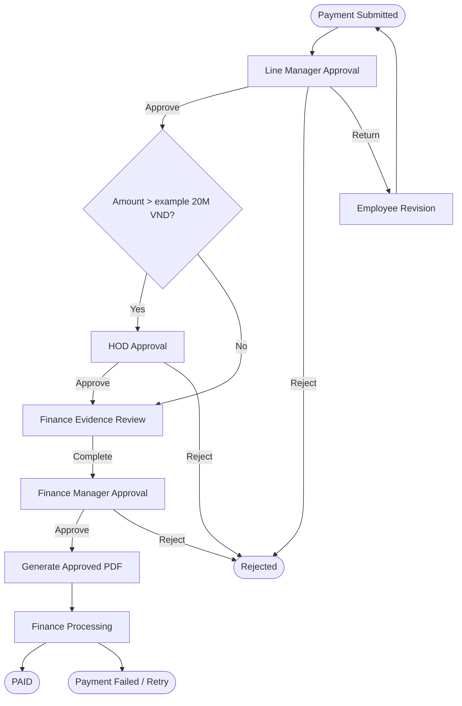

# Payment Request — V1 Business Specification

**State:** draft business template. Thresholds and finance controls are illustrative, not company policy.

## User story
Employee submits a payment request with purpose, beneficiary details, cost center and supporting documents. The line manager and additional approvers evaluate risk/value; Finance reviews proof, Finance Manager approves, a distinct Finance operator records external payment execution.

## Required input schema
| Field | Type | Policy |
|---|---|---|
| requestNo | auto number | server assigned |
| requester | user | authenticated, read-only |
| department | lookup | tenant-scoped |
| paymentPurpose | text | required |
| beneficiary | structured text | restricted/PII |
| paymentMethod | enum | CASH / TRANSFER / OTHER |
| bankDetails | restricted object | only if TRANSFER; encrypted/masked as policy |
| currency | ISO code | required |
| expenseLines | repeat group | description, quantity, unit cost, tax, subtotal |
| totalAmount | computed money | server recalculated |
| costCenter | authorized lookup | optional/required by Finance policy |
| invoiceAttachments | attachments | policy configured |

## Example route (NOT an approved policy)

Diagram's `Rev → Start` is a business depiction only; V1 runtime does **not** execute cyclic editor graphs. Revision is a controlled restart.

## Lifecycle separation
- Approval state `APPROVED` means permission granted; **does not mean money transferred**.
- `payment_state` records pending/processing/paid/failed; only Finance role can mutate with reference/time/evidence.
- Paid status must not be overwritten by a stale approval callback; payment actions are idempotent and auditable.
- Prevent accidental duplicate settlement using external transaction reference + request ID policy.

## Edge cases
Different currencies; amount changed after return; missing approver; overdue approval; invoice upload failure; duplicate submit; two-channel race; cancelled request; payout reversal; partially settled payment (V1 not supported unless Finance approves explicit business expansion).

## Acceptance
Two amount branches execute correctly; every step has actor/time; PDF exported only after final approval; employee cannot mark paid; Finance can mark paid with evidence; canceled/rejected request cannot be paid; reruns do not create duplicate payout actions.
