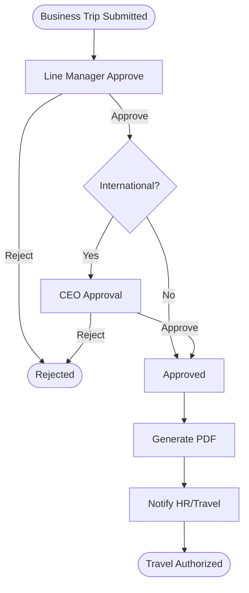

# Business Trip Request — V1 Business Specification

**State:** template proposal; HR/Travel owner must approve destination policy.

## User story
Employee requests travel authorization (destination, dates, business purpose, estimated expenses). Manager reviews; overseas trips may require additional CEO approval. Approved travel is communicated to HR/Travel and an immutable PDF record is generated.

## Input catalog
| Field | Type | Rule |
|---|---|---|
| requester / department | verified lookup | read-only user context |
| destinationCity / countryCode | text / ISO code | required |
| travelType | computed/enum | domestic/international per policy |
| startDate / endDate | date | end >= start |
| purpose | textarea | required |
| itinerary | repeating entries | city/date/transport |
| estimatedExpenseLines | repeating group | category/currency/amount |
| estimatedTotal | money | server recompute |
| advanceRequested | boolean | optional |
| advanceAmount | money | required if true, <= policy limit |
| attachments | uploaded refs | controlled |

## Example business flow

## Future linked requests (NOT V1 scope)
`Business Trip Request` → `Travel Advance` → `Travel Expense Claim` → `Settlement`. Data model should support `related_request_id` or relation table later without coupling all V1 request types.

## Special cases
Trips spanning dates; home-country config; company holiday/day boundary; changes after manager approval; multiple travelers (V1 individual per request unless policy extends); cancellation before/after approval; advance/payment still separate.

## Acceptance
International condition correctly routes to CEO; domestic bypasses; no CEO task for domestic; PDF archive and HR notification after approval; rejected trip generates no approved PDF; later form/workflow publishing does not change active trips.
