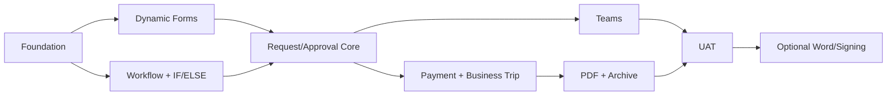

# Implementation Roadmap — V1 then V2

**Status:** Planned. No phase below is claimed done. Every line has a concrete exit gate and reproducible test evidence; no "partially complete" as final status.

| Phase | Scope | Exit gate |
|---|---|---|
| **P0** | Repo foundations, Docker dev, CI, auth scaffolding, DB migrations, observability hooks | clean install, non-destructive migrations, health checks and CI pass |
| **P1** | Form.io Core POC, Form Studio CRUD/publish, renderer, schema validation, lookups, repeating rows | Payment and Trip drafts saved/rendered; no-code schema changes; field security tests |
| **P2** | Synergy Codes CE POC + Temporal, graph editing, typed IF/ELSE, compiler, versioned workflows | two test graphs execute on real Temporal; restart/replay and invalid-graph tests pass |
| **P3** | Submission lifecycle, human task store, web approval, reject, return/revision, audit/outbox | two-actor race, idempotency, revisions, tenant isolation pass |
| **P4** | Payment and Business Trip templates, business policies, Finance processing | full request paths + negative cases proven |
| **P5** | Custom Teams Bot, Entra actor mapping, Adaptive Card update, decision shared API | Teams sandbox UAT incl. Web-vs-Teams race and stale card |
| **P6** | PDF renderer, storage adapter, archive/download, backup/restore | hash/readback, retry, ACL and restore drill pass |
| **P7** | UX hardening, load test, security/license scan, UAT, release runbook | business-owner signoff + release gates passed |
| **V2** | Word/contract review (ONLYOFFICE subject to license), signature, linked travel claims | new specs and legal/functional approval required |

## Workstream dependency

## Before owner-local QA
- README/AGENTS/architecture updated to match code.
- All P0 tests and relevant UI E2E pass; publish CI links and commit SHA.
- Create test-only user fixtures; never connect to production finance systems by default.
- Compose up/down leaves DB data unless an explicit destructive reset is requested.
- Test Web and Teams approval competing on the same task, PDF failure and worker restart.
- Report status only as **DONE (evidence)** or **IN PROGRESS/NOT DONE**; CI pass is not proof of production.

## Git and PR standards
- Feature branches and focused PRs, no unrelated refactor.
- Before code PR: list schema/API/worker/UI/migration/security impact.
- Unit/contract → DB+Temporal integration → Playwright → Teams sandbox → container smoke.
- No merge of P0 auth/double-decision defects.
- Branch protection, CODEOWNERS and production secrets are admin tasks, not inferred from docs.

## First engineering task recommendation
Implement **vertical slice** `Publish form → submit Payment Request → IF amount → web approve → persist audit` on real PostgreSQL/Temporal with no Teams/PDF mocks in the signoff path. Then add Teams and artifacts. This validates the highest-risk integration early.

## P0 prerequisite — Authorization and physical DB security
Before claiming P0/P1 complete, review [Authorization Architecture](20-AUTHORIZATION-ARCHITECTURE.md), [Permission Matrix](21-PERMISSION-MATRIX.md), [Physical Schema](22-DATA-LAYER-PHYSICAL-DESIGN.md), [PostgreSQL RLS](23-POSTGRESQL-RLS-OPERATIONS.md) and [Test Plan](24-AUTHORIZATION-TEST-PLAN.md). Convert [reference SQL](../db/design/) to reviewed migration(s), define runtime/worker/migrator GRANTs, validate actor-specific access/field masks and test under the real non-owner role. All documents are **design only** until code/tests exist.

## Master Data integration prerequisite
A new P0/P1 parallel workstream before Payment/Trip **real-data UAT**: (1) discover ERP read-only views/REST BAQ and identity/HR sources, (2) implement staged, versioned canonical masters and mapping, (3) build reliable Graph delta + ERP cursor-or-full-reconciliation workers, (4) add operator conflict/freshness UI, (5) test master lookups and task revocation/reassignment. See docs/25–29 and db/design/003–004. The first isolated workflow POC may use synthetic catalog data, but must not claim working company master sync.

## Master Data Connection Manager gating (V1)
Before declaring Master Data integration DONE: build secure Connection Manager 4-step wizard and real connection test, candidate secret vault and rotation, versioned endpoint settings, role-scoped configuration/health/audit, impact-aware disable; then separate Sync Wizard 5-step entity discover/mapping/mode/dry-run/publish paused/initial sync/enable schedule. Prove CON-01..CON-20 from [Connection Test Matrix](32-CONNECTIONS-API-DATA-CONTRACT.md), including Epicor SELECT-only and rejected cross-tenant access. Reference [Connections UX](30-CONNECTIONS-UX-FLOWS.md) and [Sequences](31-CONNECTIONS-SEQUENCE-DIAGRAMS.md). Design only until evidence exists.

## P1/P2 extra delivery gate — Master Data Node Flow Studio
Implement typed node registry, React Flow editor, optional Parse JSON, Split Items, Filter, exact Lookup/Join, visual Field Mapper, Validate/Quarantine and canonical Upsert. Demonstrate `Test Node` and `Dry Run` previews (no writes) and full real staged/incremental execution with durable checkpoints and graph-version pinning. Keep independent from Request Approval Workflow Studio. All 27 [Flow Studio QA](37-SYNC-FLOW-QA-PLAN.md) cases must be recorded, with critical security/crash cases passed, before declaring the sync feature DONE.

## Cross-cutting required workstream — FlowDocker reusable Component System
Every UI stage (P0 foundation through Flow Studio, Connections and Approval Studio) must add/extract stable generic controls into a FlowDocker-owned workspace component library. Base tokens/primitives → graph canvas/ports/node shells → JSON field mapper/input/output inspector → domain adapters. Keep runtime engines separate. A P1/P2 milestone delivering only screen-local JSX does **not** meet UI acceptance. Document public Props, isolated stories, tests, keyboard/accessibility, light/dark, visual consumer reuse and dependency/license NOTICE, per [Component Library Architecture](39-FLOWDOCKER-COMPONENT-LIBRARY.md) and [Extraction Acceptance](40-COMPONENT-EXTRACTION-ACCEPTANCE.md). Plan early extraction, not delayed end-of-project refactor. No packages currently exist.

## Owner decision: build reusable Application Platform foundations as part of E-Request
This supersedes the interpretation that only UI components need reuse. As E-Request vertical slices are built, extract **App Shell, Identity, Permission Builder/PDP, Master Data Builder/registries, Connectors/Sync and visual Form/Workflow studios** into typed application-independent workspace modules with public extension contracts. [Platform Architecture](41-FLOWDOCKER-APPLICATION-PLATFORM.md), [Master Builder](42-REUSABLE-MASTER-DATA-BUILDER.md), [Permission Builder](43-REUSABLE-PERMISSION-BUILDER.md), [App Manifest](44-APP-MODULE-CONTRACT.md), [QA](45-PLATFORM-ACCEPTANCE-AND-ROADMAP.md). A synthetic IT Assets module must prove portability beyond E-Request. This is a **cross-cutting implementation quality gate**, not a reason to pause Payment/Business Trip to develop an unbounded framework. No functional platform code exists yet.
