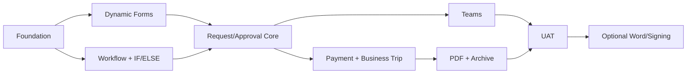

# Implementation Roadmap — V1 then V2

**Status:** Planned. No phase below is claimed done. Every line has a concrete exit gate and reproducible test evidence; no "partially complete" as final status.

| Phase | Scope | Exit gate |
|---|---|---|
| **P0** | Repo foundations, Docker dev, CI, auth scaffolding, DB migrations, observability hooks | clean install, non-destructive migrations, health checks and CI pass |
| **P1** | Form.io Core POC, Form Studio CRUD/publish, renderer, schema validation, lookups, repeating rows | Payment and Trip drafts saved/rendered; no-code schema changes; field security tests |
| **P2** | Synergy Codes CE POC + Temporal, graph editing, typed IF/ELSE, compiler, versioned workflows | two test graphs execute on real Temporal; restart/replay and invalid-graph tests pass |
| **P3** | Submission lifecycle, human task store, web approval, reject, return/revision, audit/outbox | two-actor race, idempotency, revisions, tenant isolation pass |
| **P4** | Payment and Business Trip templates, business policies, Finance processing | full request paths + negative cases proven |
| **P5** | Custom Teams Bot, Entra actor mapping, Adaptive Card update, decision shared API | Teams sandbox UAT incl. Web-vs-Teams race and stale card |
| **P6** | PDF renderer, storage adapter, archive/download, backup/restore | hash/readback, retry, ACL and restore drill pass |
| **P7** | UX hardening, load test, security/license scan, UAT, release runbook | business-owner signoff + release gates passed |
| **V2** | Word/contract review (ONLYOFFICE subject to license), signature, linked travel claims | new specs and legal/functional approval required |

## Workstream dependency

## Before owner-local QA
- README/AGENTS/architecture updated to match code.
- All P0 tests and relevant UI E2E pass; publish CI links and commit SHA.
- Create test-only user fixtures; never connect to production finance systems by default.
- Compose up/down leaves DB data unless an explicit destructive reset is requested.
- Test Web and Teams approval competing on the same task, PDF failure and worker restart.
- Report status only as **DONE (evidence)** or **IN PROGRESS/NOT DONE**; CI pass is not proof of production.

## Git and PR standards
- Feature branches and focused PRs, no unrelated refactor.
- Before code PR: list schema/API/worker/UI/migration/security impact.
- Unit/contract → DB+Temporal integration → Playwright → Teams sandbox → container smoke.
- No merge of P0 auth/double-decision defects.
- Branch protection, CODEOWNERS and production secrets are admin tasks, not inferred from docs.

## First engineering task recommendation
Implement **vertical slice** `Publish form → submit Payment Request → IF amount → web approve → persist audit` on real PostgreSQL/Temporal with no Teams/PDF mocks in the signoff path. Then add Teams and artifacts. This validates the highest-risk integration early.

## P0 prerequisite — Authorization and physical DB security
Before claiming P0/P1 complete, review [Authorization Architecture](20-AUTHORIZATION-ARCHITECTURE.md), [Permission Matrix](21-PERMISSION-MATRIX.md), [Physical Schema](22-DATA-LAYER-PHYSICAL-DESIGN.md), [PostgreSQL RLS](23-POSTGRESQL-RLS-OPERATIONS.md) and [Test Plan](24-AUTHORIZATION-TEST-PLAN.md). Convert [reference SQL](../db/design/) to reviewed migration(s), define runtime/worker/migrator GRANTs, validate actor-specific access/field masks and test under the real non-owner role. All documents are **design only** until code/tests exist.
