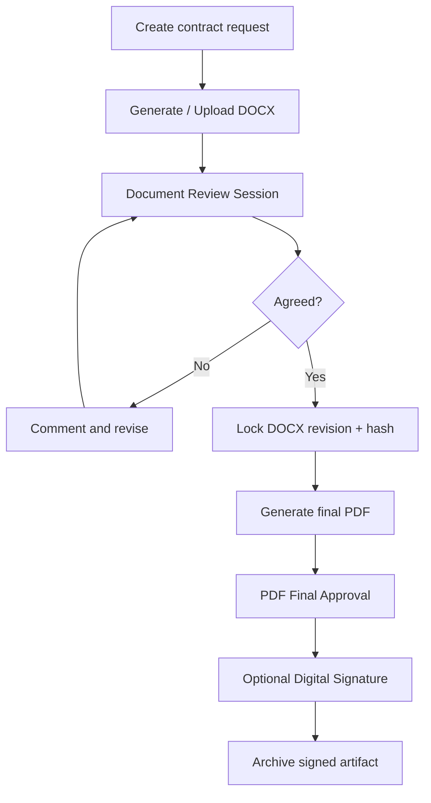

# V2 Backlog — Document Review, Word Negotiation and Signing

**Not included in V1.** V1 focuses on dynamic form requests, IF/ELSE workflow, Web/Teams approval and PDF archive.

## Future business goal
A contract or document request needs several review rounds of DOCX edits/comments/Track Changes, followed by freezing the agreed content, generating an immutable final PDF, optional final approval and qualified/other digital signing according to legal requirements.

## Candidate future components
ONLYOFFICE Docs (or another collaborative editor); controlled document versioning; review session, comments, change requests, revision/audit trail; PDF converter; signing adapter/E-Office source under its own rights and technical constraints.

## Conceptual future flow

The review loop belongs in a controlled **Document Review Session**; do not assume Workflow Builder/Temporal graph editor natively supports arbitrary cycles. If a reviewer changes content after approval, require a new immutable revision and policy-defined reapproval.

## Future licensing/compliance gate
- ONLYOFFICE Community uses AGPL-family terms with additional vendor rules; evaluate exact integration/redistribution conditions for proprietary E-Request, not just whether it runs in a separate Docker container.
- Paid Developer edition is an option, not an assumed obligation for every internal use.
- Signatures: PDF visual annotation ≠ qualified PKI/PAdES/legal certification. Validate token/certificate chain, revocation and regulatory acceptance for actual use.
- Existing FlowDocker E-Office signing code has a **source-available** license independent of the new repo; reuse or resale requires rights review.

## V2 minimum acceptance
Multiple reviewer collaboration; permission and lock enforcement; version hash before/after conversion; comments/track changes audit; reopen/reapprove rules; secure PDF/download; editor/source license signoff; browser+storage recovery UAT.
