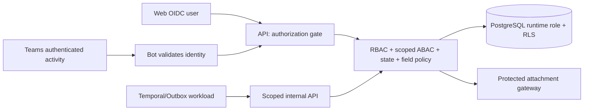

# Authorization Architecture — E-Request V1

**Status: DESIGN — no code/migration/test applied.** This document supersedes the high-level permission paragraph in the original data-model draft.

## 1. Enforcement model


Decisions require **all** relevant conditions: (a) valid/active identity, (b) matching tenant, (c) valid action grant or resource relationship, (d) matching scope, (e) correct request/task state/revision, (f) allowed fields. If anything is unknown, **deny**.

## 2. Why not just ROLE='MANAGER'?
A Manager role is for resolving an approver assignment, NOT permission to read every subordinate's finance requests. In V1 a manager sees request content when assigned an **active human task** or granted a separate explicit read entitlement. The same principle applies to Finance and tenant administrators.

## 3. Trusted identities
- Web: verify token issuer/audience/signature/expiry and Microsoft Entra tenant+object ID; map to ACTIVE local member.
- Teams: validate Microsoft Bot Framework activity and immutable Entra identity (not display name/email or card `userId`), then call the **same** approval API as Web.
- Worker: service-to-service identity, only for specific tenant/request job command. A service token **cannot pretend to be an approver**.
- The request body may contain resource identifiers, but `tenant_id`, trusted actor and roles come from backend identity + database.

## 4. Resource/action ownership
| Resource | Typical allowed relationships |
|---|---|
| `request` | creator OWN, active task's granted reader, explicit read grant, scoped Finance operator |
| `request_revision` | inherited access to owning request, but historical sensitive fields reprojected |
| `approval_task` | currently assigned active user; audited support paths separate |
| `form_definition` | scoped Form Designer for drafts/publish; everyone sees only permitted published request types |
| `workflow_definition` | scoped Workflow Designer and approved publish capabilities |
| `payment` | approved request AND scoped Finance Operator; no general employee write |
| `attachment` | request-level access PLUS attachment classification/need-to-know |
| `audit` | own summary, assigned task history summary, purpose-bound auditor |
| `user_roles` | scoped Tenant Admin for administration; no unrestricted finance-content access |

## 5. RBAC, scoped binding, ABAC
- A role defines capabilities (`request:create`, `task:decide`, `form:publish`, `payment:mark_paid`).
- A **user role assignment** carries scope `TENANT`, `DEPARTMENT`, `REQUEST_TYPE` or `REQUEST` with effective-from/until and revocation.
- A request has one tenant, department snapshot, request type, creator and immutable revisions.
- ABAC adds state, revision, original owner, active task assignee, field classification and expiration.
- A scoped role alone never overrides a stronger constraint such as **assigned task required** for `task:decide`.

### Policy pseudocode
```text
AUTH(actor, action, resource, context):
  require actor authenticated + ACTIVE
  require actor.tenant == resource.tenant
  require action capability or narrowly documented owner/task relationship
  require applicable scoped role/explicit entitlement
  require current object state + revision + valid time window
  if action == TASK_DECIDE: require actual PENDING task assigned to actor
  allow only listed fields for this action/stage
  else DENY
```

## 6. Request visibility and revocation
When Temporal activates a human approval task, app creates both (a) task assignment and (b) an explicit `request_access_grants` entry for `REQUEST_READ` scoped to assignee, request, revision, task, valid time. On task close/reassignment, revoke the grant as part of consistent business state transition. Manager does **not** keep full future request access merely because they once approved a previous revision.

For Finance processing, create a purpose-limited grant when payment operation is active; expiring grant when process closes is configurable. Old audit summary remains visible only with a separately approved policy.

## 7. Field-level security
Published `form_field_policies` store stable field key, classification and allowed read/write purposes by stage/role. Examples:
- `PUBLIC_REQUEST`: request creator and task assignee may read.
- `INTERNAL`: assigned role with need-to-know only.
- `FINANCE_SENSITIVE`: account numbers, banking details—masked by default and omitted from Teams cards, exports and logs.
- `SECRET`: deny except separate explicit approved use case.
API **projects** safe JSONB fields after row authorization; write paths reject unknown/hidden/finance-only keys even if malicious browser sends them. Encryption for especially sensitive fields is additional protection, not authorization.

## 8. RLS boundary
Reference SQL implements **tenant isolation and request read visibility** via explicit entitlement grants. Other RLS policies may be deliberately tighter (e.g. task assignee, own access grant). API still enforces actions, state, field masking, workflow version and upload/download ACL. Refer to [PostgreSQL Operations](23-POSTGRESQL-RLS-OPERATIONS.md) for limitations of custom session variables and privileged DB roles.

## 9. Permission audit and publication
Policy edits are admin actions with their own audit, reviewer and version. Role revocation applies to new commands immediately even when the JWT contains stale claims. No implicit break-glass access in V1. If support impersonation is later required, design separate time-bound, dual-approved procedure.

## 10. Business-owner questions
Does Finance have cross-department search or only assigned requests? Can staff read finished manager decisions? Does Legal/HR require special confidentiality? How to define tenant vs subsidiary? All unanswered questions default to restrictive access.
