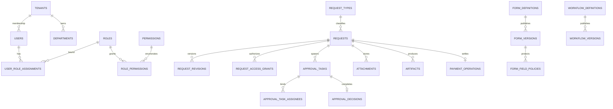

# PostgreSQL Physical Data Layer — Implementation Blueprint

**Status: DESIGN.** Reference DDL at [db/design/001_core_schema.sql](../db/design/001_core_schema.sql) is **not** a production migration.

## Entity relationships

## Schema strategy
- **UUID** as technical primary key, plus `tenant_id` on *every* business table.
- Tenant-safe composite FK references `(tenant_id,id)` even if single-column UUID is globally unique, preventing accidental cross-tenant relationships.
- Departments and users are tenant-scoped. Entra object ID is unique per provider tenant and maps to local active user.
- `roles` are capability bundles. `user_role_assignments` bind role to `TENANT`, `DEPARTMENT`, `REQUEST_TYPE`, `REQUEST` scopes; `scope_id` is validated **by application** against scope type and tenant because one polymorphic UUID cannot have a single safe FK.
- `requests` store request_type, current status and current revision; `request_revisions` keep immutable published form/workflow IDs, submitted data and hash.
- `request_access_grants` materialize active authorized readers (assignees, finance operator, explicit sharing). These grants are not simply copies of roles: they expire/revoke with the originating assignment.
- Task `status/version` and one `approval_decisions` row per task enforce single terminal transition; client idempotency keys stored for retries.
- `form_field_policies` separate field metadata and classification from arbitrary form JSON, with role/stage masks at API layer.
- `audit_events` must not be writable by request-initiating client; record resource, actor, time, command and hashes without raw finance data.
- `outbox_events` are workload-only. The shared API role should not expose unrestricted outbox/audit reads.

## Data groups
| Group | Tables | Access default |
|---|---|---|
| Organization | tenants, departments, users | active membership and org-admin scope |
| Authorization | roles, permissions, role_permissions, user_role_assignments | server authorization module |
| Authoring | form_definitions, form_versions, form_field_policies, workflow_definitions, workflow_versions, request_types | author/editor/publish capability |
| Runtime | requests, request_revisions, approval_tasks, task_assignees, request_access_grants, decisions | owner or explicit assignment/grant |
| Finance | payment_operations | authorized Finance processor |
| Storage | attachments, artifacts | request visibility AND classification |
| Operations | audit_events, outbox_events | workload and purpose-limited read |

## Index and integrity design
- Unique `tenant_id, request_no`.
- Unique `tenant_id, request_id, revision_no`.
- `approval_decisions.task_id` unique (exactly one accepted terminal decision).
- Unique `tenant_id, task_id, user_id` for assignees.
- Partial lookup indexes for `requests` by owner/status, grants by grantee/expiry, tasks by assignee/status, outbox by next retry.
- Immutable published form/workflow versions and submitted revisions should be protected by restricted UPDATE privileges and tested state transition functions; no direct external CRUD.
- Money represented by `NUMERIC(20,2)` with currency code (or integer minor units with currency-specific scale). **Do not** use JS float for money. JSONB is flexible but must be validated, projected and indexed intentionally.

## Row security
[002_rls_policies.sql](../db/design/002_rls_policies.sql) shows tenant+owner/active-grant SELECT on requests, task assignment SELECT and tenant isolation on related rows. It is a **reference**, not a certified exhaustive security policy. Sensitive JSONB field access, Finance read scopes and decision transactions MUST be enforced in API/business code, not inferred from RLS alone.

## Separate migration and worker roles
`e_request_owner`: NOLOGIN owns schema/tables; `e_request_app`: LOGIN non-owner without BYPASSRLS; `e_request_worker`: restricted privileged operations, no BYPASSRLS by default; `e_request_migrator`: CI-controlled DDL only. See RLS guide.

## Schema forward compatibility
V2 (ONLYOFFICE) adds document review sessions, track change metadata and signature artifacts, **not** required for V1. New expense modules link to parent request via a validated request relationship table.

## Master Data physical extension (design-only)
Existing users/departments are insufficient for durable source integration. New proposed tables in [003 Master DDL](../db/design/003_master_data_schema.sql) model sources, pipelines, checkpoints, run history, bounded staging, external-key maps, canonical companies/vendors/cost centers/employee profiles, effective org assignments and exception review. [004 Master RLS](../db/design/004_master_data_rls.sql) denies most direct reads; approved canonical lookups use tenant/company scope. Refer to [Master Data Architecture](25-MASTER-DATA-ARCHITECTURE.md) and [Sync Contracts](26-MASTER-DATA-SYNC-CONTRACTS.md). No migration was applied.
