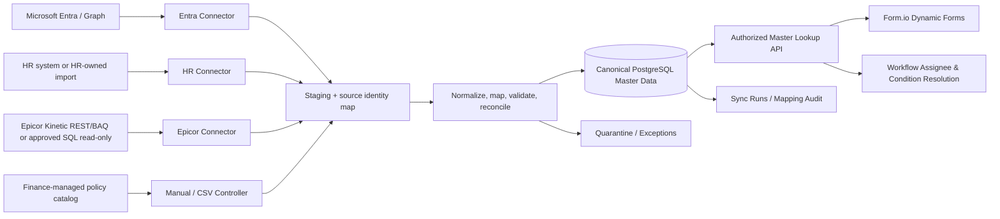

# Master Data Hub — Architecture & Source-of-Truth Matrix

**Status: DESIGN / NOT IMPLEMENTED. Last updated 2026-10-27.** Existing `users`/`departments`/lookup descriptions do **not** constitute a master-data integration implementation.

## Design decision
Every E-Request form and approval workflow reads from **tenant-scoped canonical master-data tables** owned by E-Request, NEVER directly from Entra, HRIS, Epicor or arbitrary connector endpoints at form-render time. The system **does not replace** the authoritative source. Data moves from source → connector → staging/validation/mapping → idempotent promotion → canonical PostgreSQL → safe lookup API → Form/Workflow.

## Field-level Source of Truth (SoT) — provisional
| Domain / field group | Primary SoT | Secondary/fallback | Sync mode | Notes |
|---|---|---|---|---|
| Authentication subject, Entra tenant/object ID, accountEnabled, sign-in identity | Entra ID | none for Entra identity | Graph /users/delta | Never join by display name; mailbox/email mutable |
| Employee code, employment status | HRIS **if exists** | HR-controlled verified import | HR API/CSV | Do not automatically create active roles from an unknown HR record |
| Legal department, job position, effective manager relationship | HRIS/HR owner, **to confirm** | Entra manager if designated by HR | HR daily/events; Entra manager fetch | Manager from Entra is only authoritative if formally approved |
| User ↔ employee ↔ manager mapping | Canonical identity map | approved human match | governed linking | No auto-match based solely on name/email |
| Company/legal entity and financial company code | Epicor ERP / Finance | Finance-approved curated list | BAQ/REST/SQL read-only | Must map ERP company code; multi-company keys |
| Vendor/supplier/customer codes and active status | Epicor ERP | none (manual exception only) | BAQ/REST/SQL read-only | Vendor key must include company/domain and authoritative external ID |
| Cost centers/GL account codes | Epicor Finance **if verified** | Finance-controlled list | REST/BAQ/SQL read-only or import | Validate chart-of-accounts authority before lock-in |
| Expense type, travel destination categories, approval threshold policy | E-Request Business Admin / Finance/HR policy | none | internally versioned | Do not overwrite policy from ERP automatically |
| Bank/payment methods | Finance-approved master | ERP if verified | restricted import | Keep beneficiary bank account values out of generic lookup |
| Form and workflow definitions | E-Request | none | local version/publish | Never synced from identity directory |

The ERP table names, field names, keys, endpoints, availability, retention and company approvals remain **unverified** until an actual connector discovery session. Never assume `SysRevID`, `SysRowID` or `SysDate` are present or suitable for every table.

## Ownership rule
Each canonical **field** has an `owning_source`; precedence is configured, not a blind “last write wins.” An Entra sync may update login/display properties without overriding HR-owned manager/department. Unauthorized conflicting values go to a mapping exception, not silent merge.

## Core read/write boundary
- Source connectors: **read-only** for Epicor/HR/Entra; no UPDATE/INSERT/DELETE to corporate source.
- Manual catalog owner may edit explicitly local-owned entries (travel/expense policy); source-owned canonical values are read-only in admin UI.
- Canonical records use UUID references and scoped immutable external keys; they retain `source_id`, `source_record_key`, `last_seen_at`, `last_synced_at`, `record_hash`, `lifecycle_state`, `effective_from/to` where appropriate.
- Data payloads must be allowlisted per entity; no indiscriminate ERP row dump into app tables, logs or public Git.
- All master-data reads are server-authorized and tenant-filtered, even when data is used by forms/conditions.
- For separate subsidiaries, identity tenant mapping and ERP `Company` mapping must be explicitly configured; don't equate Microsoft tenant ID with E-Request business tenant ID.

## Lifecycle and workflow invariants
1. Published request type keeps form & workflow versions.
2. Submitted request snapshots validated amount, currency, cost-center code/UUID, employee/department/manager **effective reference and display at submit** (where required for audit).
3. New approval task assignee is resolved at task activation against fresh **currently active** identity and manager relationships, with a pinned assignment-resolution policy and source freshness guard.
4. **Previously recorded decisions do not get rewritten** when a manager changes. Pending task may need cancellation/reassignment via governed reassignment, never silently auto-approved.
5. Disabled account / terminated employee: block new logins and new decisions; scheduled master sync is not an adequate alone-revocation SLA. Require live authentication validation, session revocation process and monitoring.
6. Missing/stale authoritative manager or blocked critical master: route to **ASSIGNMENT_BLOCKED** operational queue; no fallback to “first Admin” or self-approval.

## UI modules
`Administration → Master Data`: Sources, Connectors, Entity Catalog, Source Mapping, Conflict Queue, Sync Schedules/Runs, Data Quality, Manual Business Catalog, Preview Changes. Form Studio chooses lookup dataset (e.g. `master.vendors.active`) by permission, NEVER a source URL/SQL expression typed by admin.

## Business-scope safeguards
- Payment beneficiary/vendor: only active vendor for the exact ERP company; never send bank details to Teams.
- Cost center: restrict by selected company/department if policy requires.
- Business Trip: Employee and manager from organization catalog, location/country/travel policy from controlled catalog.
- Finance-only field visibility remains enforced by backend even when a lookup value is visible.

## Links
[Sync contracts](26-MASTER-DATA-SYNC-CONTRACTS.md) · [Governance/freshness](27-MASTER-DATA-GOVERNANCE.md) · [Sequences](28-MASTER-DATA-SEQUENCES.md) · [Tests](29-MASTER-DATA-TEST-PLAN.md) · [Reference DDL](../db/design/003_master_data_schema.sql) · [Agent skill](../.agents/skills/master-data-integration/SKILL.md).

## Connection Manager boundary (design addendum)
A **Connection** is reusable endpoint + encrypted-vault credential reference + versioned real-test state, not a synchronized entity. One Connection can supply many `master_sources`, each serving independently configured and checkpointed pipelines. Connection testing does not fetch full source data, advance delta tokens or start a pipeline. A separate wizard discovers approved fields, maps schema, selects Full/Incremental, performs dry run, then publishes a paused pipeline. See [Connections UX](30-CONNECTIONS-UX-FLOWS.md), [Connection API/DB](32-CONNECTIONS-API-DATA-CONTRACT.md) and [SQL extension](../db/design/005_connections_extension.sql). The earlier source.secret_reference design is to be consolidated through a versioned Connection vault reference during migration; never duplicate live secrets.
