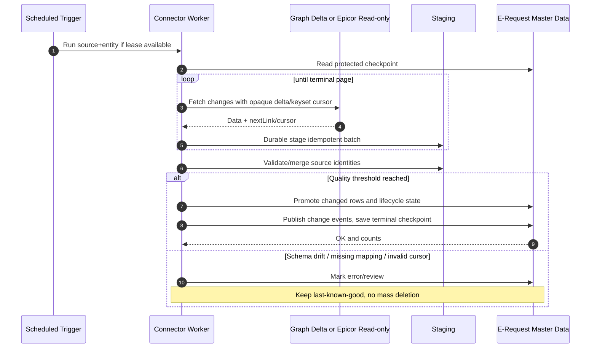
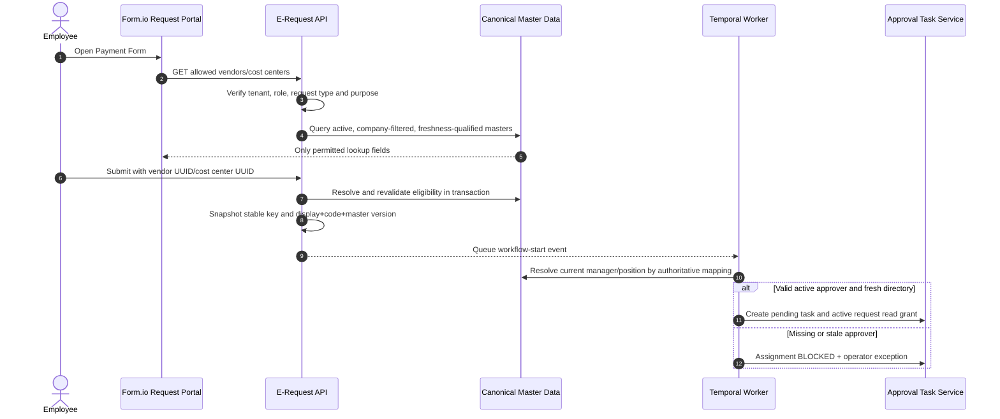

# Master Data Hub — Sequence Diagrams

**Status: design illustrations, not observed runtime.**

## MD-01 Initial bootstrap, source normalization, promotion
```mermaid
sequenceDiagram
  autonumber
  actor Ops as Integration Admin
  participant Admin as Integration Hub
  participant Scheduler as Sync Scheduler/Worker
  participant Source as Entra / HR / Epicor
  participant Stage as Staging + Mapping
  participant DB as Canonical PostgreSQL
  Ops->>Admin: Configure source, entity, field owners + verify connector
  Admin->>DB: Store source config without plaintext secret
  Ops->>Admin: Start initial sync
  Admin->>Scheduler: Create run with lock/lease
  loop each page
    Scheduler->>Source: READ page/checkpoint
    Source-->>Scheduler: Data + next cursor
    Scheduler->>Stage: Persist normalized source rows/hash/identity
    Stage->>Stage: Validate keys, FKs, duplicates, classifications
  end
  alt All required gates pass
    Scheduler->>DB: Idempotent upsert canonical + xref + change history
    DB-->>Scheduler: Applied counts and new version
    Scheduler->>DB: Commit checkpoint + success report
  else Missing keys/conflict/partial file
    Scheduler->>Stage: Quarantine affected rows
    Scheduler->>DB: Mark NEEDS_REVIEW; checkpoint not advanced past unapplied work
    Scheduler-->>Ops: Exception / action required
  end
```

## MD-02 Incremental Graph/Epicor sync


## MD-03 Request form lookup and approval assignment


## MD-04 Org changes / revocation vs pending approvals
```mermaid
sequenceDiagram
  autonumber
  participant HR as HR/Entra Change Feed
  participant Sync as Master Data Worker
  participant DB as Canonical Users / Org
  participant Task as Task Reconciliation
  participant Bot as Teams Bot
  actor Former as Former Manager
  HR->>Sync: Manager changed / account disabled
  Sync->>DB: Upsert effective manager/status + audit
  Sync->>Task: Enqueue impacted assignment review
  Task->>Task: Decide reassignment by business policy
  Task->>DB: Revoke old task grants and assign new actor atomically
  Task->>Bot: Expire prior card; send replacement if allowed
  Former->>Bot: Click cached Approve card
  Bot->>Task: Verify actual active account+assignment
  Task-->>Former: DENIED (revoked or stale)
```

## MD-05 Full reconciliation and missing records
```mermaid
sequenceDiagram
  autonumber
  actor Owner as Finance/HR Data Owner
  participant Sync as Reconciliation Job
  participant Source as Authoritative Source
  participant Stage as Complete Staged Snapshot
  participant DB as Canonical Store
  Sync->>Source: Full paged read with completeness watermark
  Source-->>Stage: Keys + counts + snapshot marker
  Stage->>DB: Compute absent source keys / conflicts
  alt Unexpected mass inactivation or incomplete snapshot
    DB-->>Owner: Review required; no records disabled
    Owner->>DB: Approve/reject exception via audited action
  else Complete and under threshold
    Sync->>DB: Soft-inactivate missing keys + audit
  end
```
