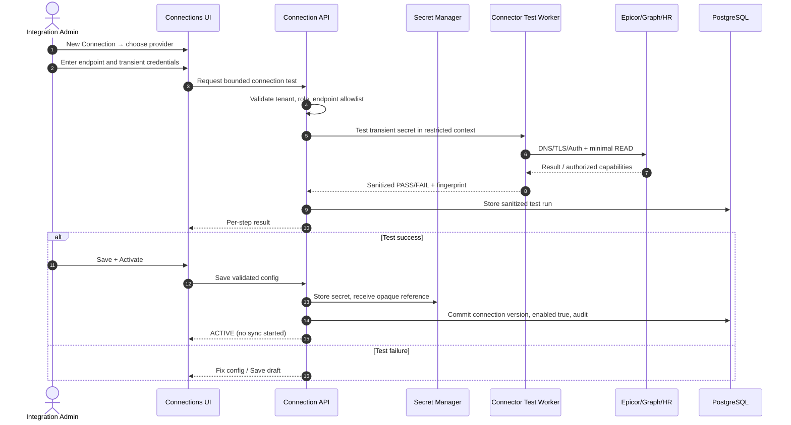
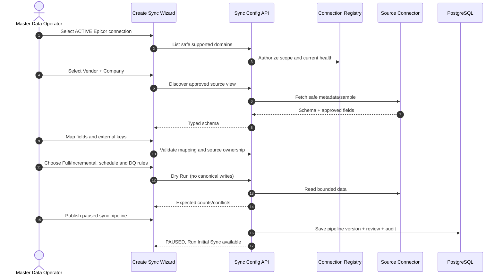
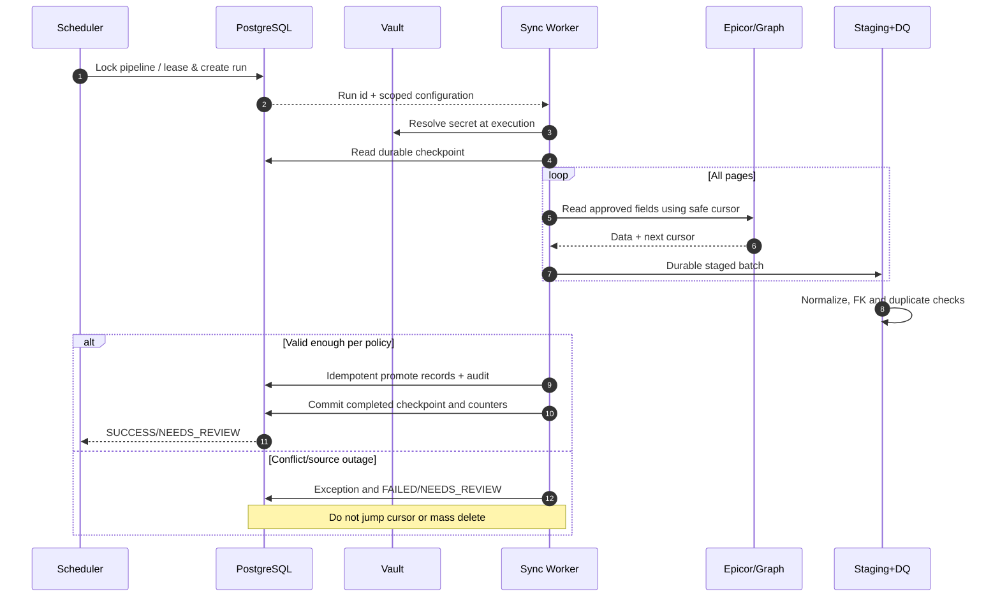
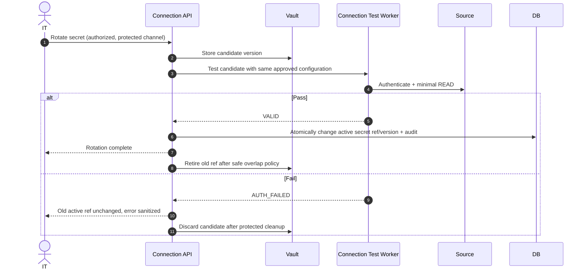
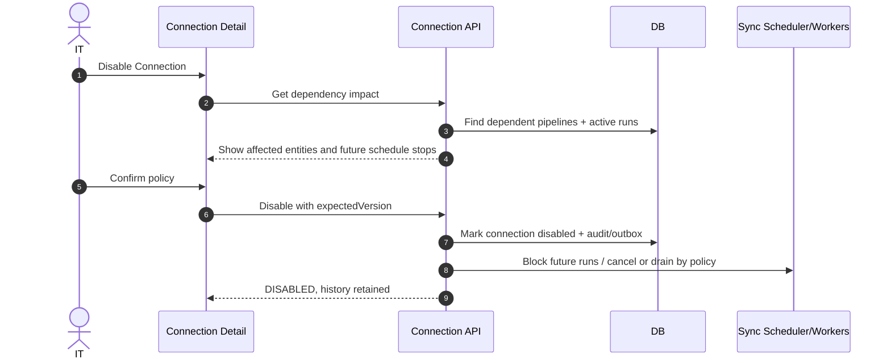
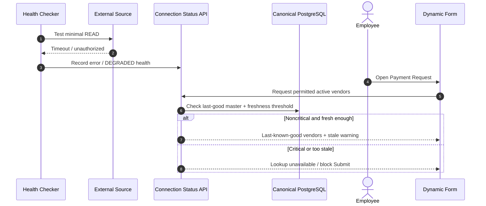

# Connections — Six Sequence Diagrams

**DESIGN ONLY**. Connection Test != Sync. All actions use authorized backend and secrets vault. Never leak credentials to logs or source data to unapproved actors.

## CN-01 Create, real test and activate Connection

Implementation nuance: a transient test success is not sufficient to activate a **different** saved secret or config. Re-test persisted vault reference/current fingerprint before ACTIVE; never store secret plaintext in test history.

## CN-02 Create source and sync pipeline from existing connection

## CN-03 Scheduled incremental sync (no UI participant)

## CN-04 Rotate credentials without downtime

## CN-05 Disable connection with running/dependent pipelines

## CN-06 Connection test failed but previously synced form lookup works

