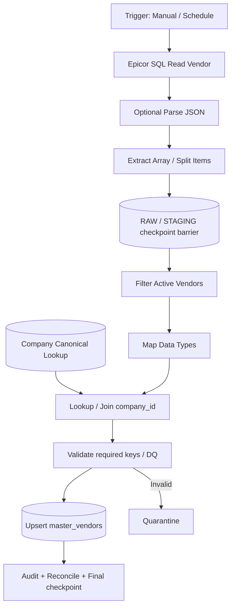

# Master Data Flow Studio — Node-based Sync & Transform (n8n-style UX)

**STATUS: DESIGN ONLY — no implementation, no running connectors, no tested nodes.** 2026-10-28.

## Product decision
Replace the *mapping-heavy* portion of the previously specified 5-step Create Sync Wizard with a **visual Flow Studio**, based on React Flow (`@xyflow/react`) and a custom bounded, typed master-data execution plan. Keep **Connection Manager** independent. There are **TWO independent workflow designers**:

1. **Master Data Flow Studio:** Source ingestion → RAW/STAGING → Parse/Filter/Map/Join → Validate → Master Upsert. Not business approval logic.
2. **Approval Workflow Studio:** Request → IF/ELSE → Human Task → Teams/Web → PDF. Uses distinct Temporal orchestration and task semantics.

Shared graph-editor UI primitives where practical; do not use the existing E-Office Runtime V2. **Do not import/clone n8n's editor or runtime** as product code. React Flow is an MIT-licensed library; n8n uses Sustainable Use License, with commercial/OEM conditions for embedded products.

## Navigation
`Administration → Master Data → Connections | Sources | Flow Studio | Runs & Logs | Catalog | Data Quality`.

Connections is a secure and reusable endpoint + auth profile. Source is the approved logical dataset/view/Graph endpoint. Flow has versioned graph, mapping and execution plan. The operator must **create/select an ACTIVE Connection** before adding Source nodes. A Connection test must not start sync or advance the cursor.

## Canvas structure: explicitly separate extraction and transform


**Parse JSON is optional** when the connector already returns structured JSON. Add it when an upstream string field contains escaped JSON or a response requires explicit extraction; do not force it on every SQL response.

**RAW/STAGING barrier:** source fetch and immutable staged payload complete before transformations are promoted to canonical tables. Each pipeline stores separate extraction checkpoint, staged page identity and application state. A staged-only cursor cannot become an authoritative completed checkpoint until promotion obligations for that checkpoint have been met (or a durable per-record retry/dead-letter model explicitly accounts for pending rows).

## Node library V1
| Group | Node | Input → Output | Core settings |
|---|---|---|---|
| Trigger | Manual, Schedule | Event → run context | disabled by default / cron config |
| Source | Epicor SQL approved View/BAQ, Epicor REST, Entra Graph Delta, HR REST, Managed File | Source connection → paged batch | connectionRef, company scope, approved source, pageSize, mode |
| Extract | Parse JSON | JSON string → object/array | JSON path, schema and error port |
| Extract | Extract Items / Split Array | JSON array → row stream | JSON path and provenance |
| Transform | Select/Rename Fields | item → item | source schema paths |
| Transform | Convert Types | item → typed item | string/date/decimal/bool formats |
| Transform | Filter | item → accepted/rejected | allowlisted typed expressions |
| Transform | Set/Derive | item → item | whitelisted functions e.g. trim, coalesce, concat |
| Transform | Lookup / Join | item + bounded dimension lookup → enriched item | keys and exact match semantics |
| Transform | Deduplicate | batch/key → unique + conflict | stable key, compare version/hash |
| Transform | Aggregate (optional P1) | finite window → computed batch | bounded group; not unrestricted |
| Quality | Validate | item → valid/errors | required keys, enum, company match, FK |
| Quality | Quarantine | invalid item → secured exceptions | safe errors, reason, retry status |
| Target | Master Upsert | validated rows → canonical entities | target allowlist, external identity, idempotency |
| Target | Audit / Metrics | result → counts/events | no sensitive values |
| Control | Fail/Stop, Conditional branch | typed control signals | explicit error policy |

**No V1 arbitrary JS Code node or arbitrary SQL/HTTP endpoint from admin graph.** A future developer SDK may add signed approved custom nodes isolated in worker sandbox with security review. Graph editor is not equivalent to production execution.

## User interface
```text
┌──────────────────────────────────────────────────────────────────────────┐
│ MASTER DATA › FLOW STUDIO    [Draft] [Save] [Test Step] [Dry Run] [Publish]│
├──────────────┬──────────────────────────────────────────┬────────────────┤
│ NODE PALETTE │                FLOW CANVAS               │ NODE PROPERTIES│
│ ▸ Trigger    │  [Epicor SQL Vendor]→[Split Items]       │ Selected: Join │
│ ▸ Source     │                     ↓                    │ Left key       │
│ ▸ Extract    │           --- RAW/STAGING ---            │ [Company]      │
│ ▸ Transform  │                     ↓                    │ Right dataset  │
│ ▸ Filter     │ [Filter Active]→[Join Company]            │ [master.company]│
│ ▸ Lookup/Join│                     ↓                    │ Join type      │
│ ▸ Validate   │ [Drag Mapper]→[Validate]→[Upsert Vendor]  │ [LEFT/INNER]   │
│ ▸ Target     │                                          │ [Test Node]    │
├──────────────┴──────────────────────────────────────────┴────────────────┤
│ DATA INSPECTOR: Input sample | Output sample | Errors | Schema | Run logs │
└──────────────────────────────────────────────────────────────────────────┘
```

Node selection: show metadata, input/output schemas, path picker, sample values, execution count and errors. `Run Node` on synthetic or redacted sample is a bounded sandbox read/transform; never writes canonical. `Dry Run Flow` stages/validates but does not commit master upserts or advance authoritative checkpoint. `Run Sync` runs published version with runtime permissions and explicit confirmation.

## Drag-and-drop mapping as first-class UX
Mapper opens a three-pane workspace: **INPUT JSON TREE** (left) → **MAPPING ROWS/CANVAS** (middle) → **TARGET CANONICAL SCHEMA** (right), plus Preview. Dragging `$.Name` to `display_name` adds a typed binding, transform optional; adding `Company` → `company_id` requires a lookup, not a naive text-to-UUID cast. Allow explicit constants, safe defaults, concatenation, type conversion, IF/ELSE for fields, and null policy.

Edges carry **records/typed batches**, not only success/failure signals. Each node contract identifies node ID, typed ports, schema, item lineage and bounded error output. Graph compilation rejects dangling edges, schema mismatch, missing required mapping, cycles (not allowed V1), Join without cardinality rule, dangerous cross-company joins, and sink nodes that can receive unvalidated records.

## UX flows
1. **Create connection:** Administration → Connections → New → Configure → Real Test → Activate.
2. **New Master Data Flow:** Flow Studio → + New → select canonical target (e.g. Vendors) → choose approved active Connection → source view/BAQ → add Source node.
3. **Sample input:** Test Source (limit, synthetic/redacted), inspect JSON tree; add Parse JSON only if data arrives as JSON text; Split Items if upstream returns array.
4. **Transform graph:** Filter; map; join known Company canonical master; add Validate, Upsert target and error output.
5. **Debug:** execute a single node or Dry Run all nodes using bounded staged sample; show Input/Output/Error and field-level mapping previews.
6. **Publish and bootstrap:** validate graph, source permissions and field ownership; publish immutable version `PAUSED`; run initial full/safe incremental bootstrap; verify counts.
7. **Operationalize:** enable schedule; inspect Runs & Logs, invalid rows/quarantine, stage/apply lag, lineage and checksum; owner may disable/pause.
8. **Change mapping:** save draft new graph version, dry-run diff against current; publish with impact review, never mutate in-flight graph version.

## Top risks
- Preview cannot reveal source secrets, personal records, bank data, or unbounded samples; all masked/tenant-scoped.
- A large Epicor table cannot be fully downloaded to the browser for mapping; preview only first N allowed items; runtime processes bounded pages/streams.
- Joins with large source datasets require bounded hash/lookup queries or staged relational joins, not browser in-memory all-to-all joins.
- Version and cursor compatibility: changing a key, map or target requires explicit strategy for rebootstrap/backfill; never continue incompatible cursor silently.
- One source may have multiple downstream targets; prevent partial canonical updates by a verified commit policy and per-sink idempotency ledger.
- Form Studio and Request Approval Studio depend on **published canonical master** only, never staged/raw row data.

## Design references
[Mapper & execution contract](35-MAPPING-EDITOR-EXECUTION.md) · [Flow sequences](36-SYNC-FLOW-SEQUENCES.md) · [Schema reference 006](../db/design/006_node_sync_graphs.sql) · [Connections UX](30-CONNECTIONS-UX-FLOWS.md) · [Master Sync](26-MASTER-DATA-SYNC-CONTRACTS.md).

## License guidance
- React Flow: MIT open-source UI library [reactflow.dev](https://reactflow.dev/)
- n8n data mapping concept [n8n docs](https://docs.n8n.io/data/data-mapping/data-mapping-ui/)
- n8n Sustainable Use License [official repo](https://github.com/n8n-io/n8n/blob/master/LICENSE.md)
Use **original code** for node palette/editor/worker; no unsupported assumption that n8n editor can be repackaged commercially for free.

## Reuse requirement (new)
The owner requires **a proprietary-to-FlowDocker/original reusable component library**, not one-off sync editor JSX. Extract BaseNodeCard, FlowCanvas, PortHandle, JSON Tree Explorer, Target Field Slot, Mapping Editor and Input/Output Inspector into proposed workspace packages with typed public APIs, stories and tests. Keep Epicor/Graph connection config and Transform/Upsert execution logic in sync-domain adapters; the approval graph can reuse visual canvas primitives without inheriting sync logic. See [Component library](39-FLOWDOCKER-COMPONENT-LIBRARY.md), [extraction/acceptance](40-COMPONENT-EXTRACTION-ACCEPTANCE.md). This is still a design, not implemented UI.
