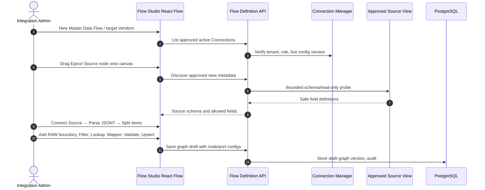
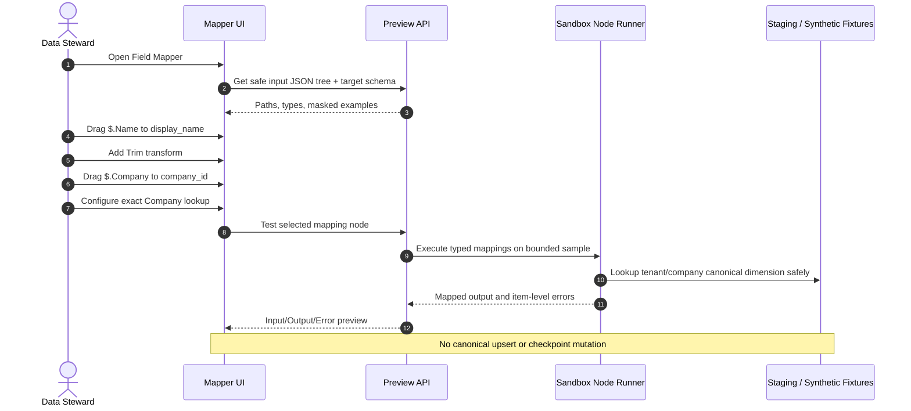
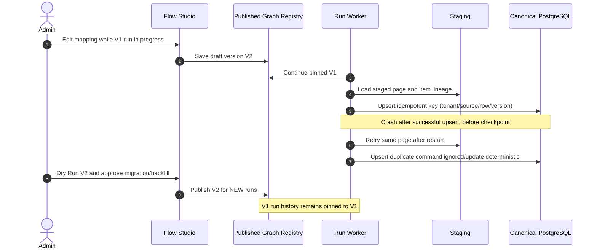

# Visual Master Data Sync — Five Sequence Diagrams

**DESIGN ONLY / no code executed.** The operator edits a data-flow DAG; this is distinct from the Request Approval Workflow Studio.

## FL-01 — Build visual data pipeline


## FL-02 — Drag/drop JSON mapping and test node


## FL-03 — Validate graph, Dry Run, Publish PAUSED
```mermaid
sequenceDiagram
  autonumber
  actor Owner as Master Data Owner
  participant Studio as Flow Studio
  participant Compiler as Graph Compiler
  participant Sandbox as Preview Executor
  participant DB as PostgreSQL
  Owner->>Studio: Validate Flow
  Studio->>Compiler: Parse nodes, typed ports, mapping and cursor
  alt Graph invalid
    Compiler-->>Studio: Blockers: keys/type/joins/missing targets
  else Valid
    Compiler-->>Studio: Safe compiled DAG
    Owner->>Studio: Dry Run Flow
    Studio->>Sandbox: Fetch bounded safe sample and simulate target diff
    Sandbox-->>Studio: Predicted Insert/Update/Quarantine counts
    Owner->>Studio: Publish with reviewer approval
    Studio->>DB: Save immutable compiled graph version as PAUSED
    DB-->>Studio: Version published; NO sync running
  end
```

## FL-04 — Initial sync, stage barrier, transform and promote
```mermaid
sequenceDiagram
  autonumber
  actor Operator
  participant API as Flow Run API
  participant Orchestrator as Temporal / Run Orchestrator
  participant Source as Approved Epicor / Graph Source
  participant RAW as Durable Staging
  participant Worker as Typed Batch Executor
  participant Canonical as Canonical Master PostgreSQL
  Operator->>API: Run Initial Sync (published graph version)
  API->>Orchestrator: Start scoped run via outbox + lease
  loop Bounded source page
    Orchestrator->>Source: Read approved fields with cursor/page token
    Source-->>Orchestrator: Source rows, source keys and next page token
    Orchestrator->>RAW: Stage page + hash + lineage durably
  end
  Orchestrator->>Worker: Execute compiled transform nodes over staged batches
  Worker->>Worker: Parse optional, Filter, Lookup, Map, Validate
  alt All gating rules satisfied
    Worker->>Canonical: Idempotent upsert + audit/change events
    Canonical-->>Worker: Persisted records and metrics
    Worker->>RAW: Mark applied; checkpoint commit when obligations satisfied
    Orchestrator-->>API: Run COMPLETE with applied counts
  else Invalid/missing company/source drift
    Worker->>RAW: Quarantine rows / mark Needs Review
    Note over Worker,Canonical: No skipped critical checkpoint
    Orchestrator-->>API: Operator resolution required
  end
```

## FL-05 — Retry after crash and flow version upgrade

