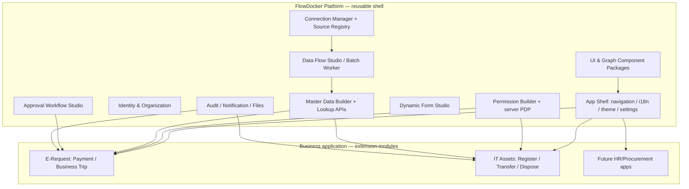

# FlowDocker Application Platform — Reusable Application Shell & Modules

**Status: ARCHITECTURE DESIGN ONLY — not implemented, tested, installed, or independently packaged.** Date: 2026-10-28.

## Owner's product requirement
**"Build the shell once, implement only the business-specific core for the next app."** E-Request is the first reference consumer, not the platform boundary. This extends [FlowDocker Component Library](39-FLOWDOCKER-COMPONENT-LIBRARY.md) from UI-only reusability to **application services + runtime contracts + authorization/master-data governance**.

**Target, not a guarantee:** reuse most of navigation, identity, permission builder, master-data catalog, connector management, data-sync studio, form builder, human-approval tooling, audit, notifications and UI. Domain apps still need business services, validation, migrations, tests and compliance-specific policies.

## Architecture

**No blanket shared execution engine:** Data Sync Flow and Approval Workflow can share canvas/editor UI contracts, but **not** worker semantics, business state machines or access checks. Domain-specific background jobs have explicit extension interfaces.

## Reusable platform modules
| Package (proposed; no code yet) | Responsibility / public extension point |
|---|---|
| `@flowdocker/app-shell` | Authenticated layout, navigation registry, breadcrumbs, theme, i18n, settings, error boundary |
| `@flowdocker/identity` | OIDC identity adapter, account lifecycle, tenant membership, org/team/manager references |
| `@flowdocker/authorization` | Policy registry, RBAC+scope/ABAC evaluation (PDP), API enforcement hooks (PEP), row/field masks |
| `@flowdocker/permission-builder` | Role/capability matrix, condition builder, policy preview/simulation/version-publish UI |
| `@flowdocker/master-data` | Entity definition registry, canonical catalog CRUD, import/sync bindings, versioned value history, safe lookup projection |
| `@flowdocker/master-builder` | Admin entity/field/reference/validation/ownership designer and publish UI |
| `@flowdocker/connections` | Secure external connector profiles, health, secret reference/rotation and approved source catalog |
| `@flowdocker/sync-engine` | Staging, idempotent batch apply, checkpoints, typed node handlers; not generic human-approval engine |
| `@flowdocker/form-studio` | Dynamic form definitions and safe rendering/validation |
| `@flowdocker/approval-runtime` | Human task and workflow integration with app-specific definitions; no sharing with sync executor |
| `@flowdocker/audit` / `notifications` / `files` | History, outbox adapters, masking, delivery, storage gateways |
| `@flowdocker/ui`, `flow-canvas`, `field-mapper` | Reusable visual primitives with typed contracts; see docs/39–40 |

Packages may start **inside the E-Request monorepo** as internal workspace modules. Do **not** create a separate platform service/repository until a stable API, working tests and an independent second consumer demonstrate the boundary. Extract over real vertical slices rather than architecting dozens of empty packages.

## Platform vs domain ownership
| Question | Reusable platform | Domain-specific "ruột" |
|---|---|---|
| Who may access this route? | Identity/role/scope/policy evaluator and nav filtering | Register resource/action and any special business predicates |
| Where does lookup come from? | Master entity schema, approval, sourcing, sync, safe lookup | Declare entity and source/ownership/map; special calculation if needed |
| How is list/create/edit drawn? | Generic schema-backed list/form for simple catalogs | Specialized screens and domain commands |
| How is approval executed? | Human task, Web/Teams adapter, audit/idempotency | Approval definitions, conditions, payment/trip states |
| How are records persisted? | Tenant isolation helpers, audit/outbox, migrations conventions | Typed domain tables and transaction/consistency rules |
| How is UI assembled? | App shell / UI kit / route/menu module registry | Feature route components and callbacks |

## Important anti-goal: "no-code everything"
- **Simple admin-owned catalogs:** metadata-defined schema, standard CRUD and safe validation can often avoid feature code.
- **Finance, HR and approval transactions:** must use explicit typed business handlers + tests. Avoid a generic EAV table or arbitrary user-script rule pretending to implement banking/payment/accounting logic.
- A field in Master Data Builder is not automatically authorized merely because it is visible in the form. The Permission Builder protects API, database views and exports.
- Reusability is not permission to copy whole company/user data across unrelated apps/tenants; each app/environment gets scoped access.

## Default extension method
1. Scaffold a new app instance using platform shell.
2. Register `AppManifest` (ID/version, module list, navigation, resource/action declarations).
3. Declare custom master entities and import connectors; map company/tenant authority.
4. Configure roles + policy templates via Permission Builder; simulate then publish reviewed policy version.
5. Build domain APIs, typed tables/migrations and domain UI components.
6. Add form/workflow definitions if required; connect to platform hooks and publish versions.
7. Run authorization, data-quality and business integration tests, license/SBOM and UAT.

See [Application Module Contract](44-APP-MODULE-CONTRACT.md) for concrete examples.

## Multi-app isolation and shared deployment choices
- `tenant_id` is the hard boundary; `app_id` scopes module resources, menu, policies, entity registries and business data when apps share an installation.
- **Do not** assume all FlowDocker apps must use the same PostgreSQL schema/database or authentication provider. Provide adapters; share capabilities/contracts, not a global privileged DB login.
- Separate DEV/QA/PROD secret stores, policy publish and connector credentials; no cross-environment source access by default.
- Cross-app shared people and master catalogs need explicit scope, ownership and agreement. An app cannot create roles that silently grant access to another app's data.
- Centrally deployed control plane is a **future option**, not a V1 requirement. Prefer modular monolith/workspace package deployment first.

## Decision and implementation gates
- First platform consumer: E-Request Payment and Business Trip modules.
- Second consumer to prove portability: **synthetic IT Asset Management reference module**, at minimum a standalone app-shell + master/permission integration test, not necessarily a full product.
- Required: no E-Request imports in reusable modules; typed public APIs; testable without Epicor/Teams; docs, Storybook, CI and versioning; real backend policy enforcement with negative tests.
- Separate platform repository `flowdocker-platform` is a **future proposal only**. The current requested source of truth is this E-Request GitHub documentation.
- No package currently DONE. Track separately **DESIGN DONE** and **IMPLEMENTATION NOT DONE**.

## References
- [Master Data Builder](42-REUSABLE-MASTER-DATA-BUILDER.md)
- [Permission Builder](43-REUSABLE-PERMISSION-BUILDER.md)
- [App Manifest](44-APP-MODULE-CONTRACT.md)
- [Platform QA & extraction](45-PLATFORM-ACCEPTANCE-AND-ROADMAP.md)
- [Component Library](39-FLOWDOCKER-COMPONENT-LIBRARY.md)
