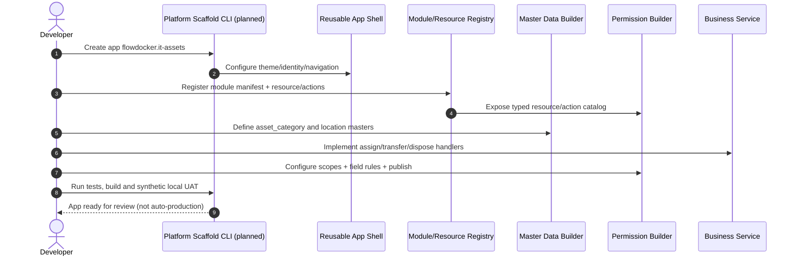

# FlowDocker New-App Contract — "Keep the shell, implement only the business core"

**Status: design-only TypeScript interface examples, no generator or code exists.**

## Goal
A new app assembles approved reusable platform modules, then registers **business extension functions** (domain state, commands, queries, views, rules). App Shell and Master/Permission Builders discover published modules by a validated manifest.

## App/Module manifest example
```typescript
// Design sketch: shape must be refined in a real typed package and validated
// at build/start-up. This is not a copy-paste runnable program.
interface FlowDockerModuleManifest {
  id: string;                   // stable: "e-request.payment" / "it-assets.inventory"
  version: string;              // semantic version
  appId: string;                // stable app scope
  title: Record<string, string>;
  navigation: Array<{
    route: string; label: string; iconKey: string;
    requiredCapability: string;  // UI hint, never backend authority
  }>;
  resources: Array<{
    key: string; // "payment_request" / "it_asset"
    actions: string[]; // only backend handlers registered with the manifest
    fieldClassifications?: Record<string, "PUBLIC_REQUEST"|"INTERNAL"|"FINANCE_SENSITIVE"|"SECRET">;
  }>;
  masterEntities: Array<{
    key: string; entityDefinitionVersion: number;
    ownedBy: "PLATFORM_LOCAL"|"DOMAIN"|"EXTERNAL_SOURCE";
  }>;
  handlers: string[];          // only allowlisted implemented business command IDs
  migrations: string[];        // domain-owned migration identifiers
  requiredPlatformCapabilities: string[];
}
```

## E-Request application manifest (illustrative)
```json
{
  "id": "payment",
  "appId": "flowdocker.e-request",
  "version": "0.1.0",
  "title": {"vi": "Yêu cầu thanh toán", "en": "Payment Request"},
  "navigation": [
    {"route": "/requests/payment/new", "label": "Payment Request", "iconKey": "receipt", "requiredCapability": "payment:create"}
  ],
  "resources": [
    {"key": "payment_request", "actions": ["create","read","submit","cancel","review","mark_paid"],
     "fieldClassifications":{"beneficiaryBankAccount":"FINANCE_SENSITIVE"}}
  ],
  "masterEntities": [
    {"key": "expense_type", "entityDefinitionVersion": 1, "ownedBy": "PLATFORM_LOCAL"},
    {"key": "vendor", "entityDefinitionVersion": 1, "ownedBy": "EXTERNAL_SOURCE"}
  ],
  "handlers": ["payment.submit", "payment.mark_paid"],
  "migrations": ["payments-v1"],
  "requiredPlatformCapabilities": ["identity", "authorization", "master-data", "approval-workflow"]
}
```
Form schema and approval graph are independently published versions linked to this module; adding a `mark_paid` action in a JSON manifest **does not implement** payment posting/settlement logic.

## Reference new app: IT Asset Management
```json
{
  "id": "inventory",
  "appId": "flowdocker.it-assets",
  "version": "0.1.0",
  "title": {"vi": "Quản lý tài sản IT", "en": "IT Assets"},
  "navigation": [
    {"route": "/assets", "label": "Assets", "iconKey": "computer", "requiredCapability": "asset:read"}
  ],
  "resources": [
    {"key": "it_asset", "actions": ["create","read","assign","transfer","dispose"]}
  ],
  "masterEntities": [
    {"key": "asset_category", "entityDefinitionVersion": 1, "ownedBy": "PLATFORM_LOCAL"},
    {"key": "location", "entityDefinitionVersion": 1, "ownedBy": "PLATFORM_LOCAL"}
  ],
  "handlers": ["asset.assign", "asset.transfer", "asset.dispose"],
  "migrations": ["assets-v1"],
  "requiredPlatformCapabilities": ["identity", "authorization", "master-data", "audit"]
}
```

## Standard extension interfaces (design)
```typescript
type BusinessCommandContext = {
  tenantId: string; appId: string; actorId: string; correlationId: string;
};
interface BusinessModule {
  manifest: FlowDockerModuleManifest;
  commands: Record<string, (ctx: BusinessCommandContext, input: unknown) => Promise<unknown>>;
  queries: Record<string, (ctx: BusinessCommandContext, input: unknown) => Promise<unknown>>;
  views: Record<string, () => Promise<unknown>>;
}
```
Implementation must replace `unknown` with typed validated request/result schemas; command entrypoint uses trusted authenticated context, server-side policy check, transaction, audit and idempotency as appropriate.

**Business handlers must not inherit god-mode CRUD.** Each request command declares required action/resource/scope and uses a reviewed business transaction. Platform audit/outbox hooks assist but do not fabricate domain constraints.

## New app setup workflow


## Decoupling and versioning rules
- Platform packages cannot import `e-request` business code.
- Applications may import published platform APIs, with explicit compatible versions; no deep/private imports.
- App manifest is declarative and validated, but not allowed to authorize actions without a registered backend implementation.
- Shared master catalog may be consumed by multiple apps but each uses scoped visibility and stable references.
- Use domain migrations for domain data; platform migration for registry/permission/master definitions.
- Refactor duplicated UI when stable; avoid speculative platform extraction without a concrete second consumer.
- Admin-defined roles, master entity versions and module manifests are auditable and rollbackable.
- Routing from shared App Shell relies on manifest UI guard; backend policy engine still denies unauthorized commands.

## Minimum second-consumer demonstration
After E-Request platform vertical slice is functioning, create a **synthetic IT Assets demo** that uses the exact same App Shell + Master Builder + Permission Builder packages. It needs one catalog (`asset_category`), one protected resource (`it_asset`), two role scopes, and one domain handler (`asset.assign`) to prove real backend + UI portability. A screenshot of two similar apps is not sufficient.
